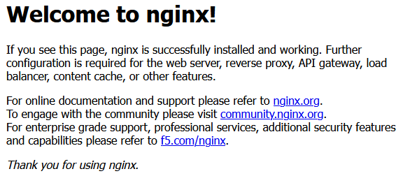
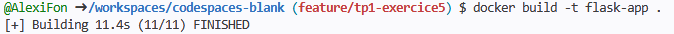
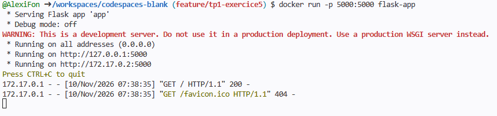

## Exercice : Manipulation de base des conteneurs
### 1. Vérifiez la version de Docker :
docker --version
→ Affiche la version installée de Docker.

@AlexiFon ➜ /workspaces/codespaces-blank $ docker -v
Docker version 29.9.2-2, build a82e528901260c8df6073311379eac65f92db204

### 2. Listez les images disponibles sur votre machine :
docker images
→ Montre toutes les images stockées localement.

@AlexiFon ➜ /workspaces/codespaces-blank $ docker images
                                                                                                                                                            i Info →   U  In Use
IMAGE   ID             DISK USAGE   CONTENT SIZE   EXTRA

### 3. Téléchargez une image depuis Docker Hub :
docker pull hello-world
→ Télécharge l'image officielle "hello-world".

@AlexiFon ➜ /workspaces/codespaces-blank $ docker pull hello-world
Using default tag: latest
latest: Pulling from library/hello-world
4f55086f7dd0: Pull complete 
d5e71e642bf5: Download complete 
Digest: sha256:c567b231f65614688711a75f31518a064258a51d442117a3e771a3a8fdba78ef
Status: Downloaded newer image for hello-world:latest
docker.io/library/hello-world:latest

### 4. Exécutez un conteneur à partir de l'image :
docker run hello-world
→ Lance un conteneur qui affiche un message de bienvenue.

@AlexiFon ➜ /workspaces/codespaces-blank $ docker run hello-world

Hello from Docker!
This message shows that your installation appears to be working correctly.

To generate this message, Docker took the following steps:
 1. The Docker client contacted the Docker daemon.
 2. The Docker daemon pulled the "hello-world" image from the Docker Hub.
    (amd64)
 3. The Docker daemon created a new container from that image which runs the
    executable that produces the output you are currently reading.
 4. The Docker daemon streamed that output to the Docker client, which sent it
    to your terminal.

To try something more ambitious, you can run an Ubuntu container with:
 $ docker run -it ubuntu bash

Share images, automate workflows, and more with a free Docker ID:
 https://hub.docker.com/

For more examples and ideas, visit:
 https://docs.docker.com/get-started/

### 5. Listez les conteneurs en cours d'exécution :
docker ps
→ Montre les conteneurs actifs.

@AlexiFon ➜ /workspaces/codespaces-blank (main) $ docker ps
CONTAINER ID   IMAGE     COMMAND   CREATED   STATUS    PORTS     NAMES

### 6. Listez tous les conteneurs (actifs et stoppés) :
docker ps -a
→ Affiche tout l’historique des conteneurs.

@AlexiFon ➜ /workspaces/codespaces-blank (main) $ docker ps -a
CONTAINER ID   IMAGE         COMMAND    CREATED          STATUS                      PORTS     NAMES
4cef04c1055f   hello-world   "/hello"   17 seconds ago   Exited (0) 17 seconds ago             crazy_williamson

### 7. Supprimez un conteneur :
docker rm <ID_conteneur>

@AlexiFon ➜ /workspaces/codespaces-blank (main) $ docker rm 4cef04c1055f
4cef04c1055f

### 8. Supprimez une image :
docker rmi <ID_image>

@AlexiFon ➜ /workspaces/codespaces-blank (main) $ docker rmi hello-world
Untagged: hello-world:latest
Deleted: sha256:c567b231f65614688711a75f31518a064258a51d442117a3e771a3a8fdba78ef

## Exercice : Création d'un serveur web avec Docker
### 1. Téléchargez l'image officielle Nginx :
docker pull nginx

@AlexiFon ➜ /workspaces/codespaces-blank (feature/exercice4) $ docker pull nginx
Using default tag: latest
latest: Pulling from library/nginx
6d2e43921e9e: Pull complete 
37fb86c2a767: Pull complete 
512ac5e7ce8e: Pull complete 
1724c05f72c6: Pull complete 
1962e1ff75b4: Pull complete 
bbb080c71d50: Pull complete 
7cb4701ce7cd: Pull complete 
d2c7e31f04a3: Download complete 
4582dace95e2: Download complete 
Digest: sha256:165ddde8751e75a1c907d24ef10d9f6deb08b57e0fe56caf67512486aff76d82
Status: Downloaded newer image for nginx:latest
docker.io/library/nginx:latest

### 2. Lancez un conteneur Nginx en arrière-plan :
docker run -d -p 8080:80 --name mon_nginx nginx
→ Démarre un serveur web accessible sur http://localhost:8080.

@AlexiFon ➜ /workspaces/codespaces-blank (feature/exercice4) $ docker run -d -p 8080:80 --name mon_nginx nginx
6593e3d374013d2194fbfc011d8206b7b1795a4ecdf8fe286df4874a6a99b837

### 3. Vérifiez que le conteneur est actif :
docker ps

@AlexiFon ➜ /workspaces/codespaces-blank (feature/exercice4) $ docker ps
CONTAINER ID   IMAGE     COMMAND                  CREATED          STATUS          PORTS                                     NAMES
6593e3d37401   nginx     "/docker-entrypoint.…"   31 seconds ago   Up 30 seconds   0.0.0.0:8080->80/tcp, [::]:8080->80/tcp   mon_nginx

### 4. Accédez à la page dans votre navigateur pour voir la page par défaut de Nginx.

### 5. Arrêtez le conteneur :
docker stop mon_nginx

@AlexiFon ➜ /workspaces/codespaces-blank (feature/exercice4) $ docker stop mon_nginx
mon_nginx

### 6. Supprimez le conteneur :
docker rm mon_nginx

@AlexiFon ➜ /workspaces/codespaces-blank (feature/exercice4) $ docker rm mon_nginx
mon_nginx

## Exercice : Déploiement d'une application Python Flask

